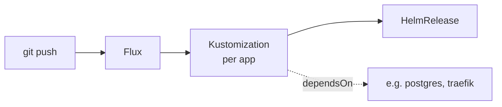

<div align="center">

# RAFI MACHINES

**Standalone Reusable Infrastructure Tasks**

_Orchestrate my haze._ A public edge server and a home Kubernetes cluster,
driven by [just](https://just.systems) and [Flux](https://fluxcd.io).

[](https://k3s.io)&nbsp;
[](https://fluxcd.io)&nbsp;
[](https://gateway-api.sigs.k8s.io)&nbsp;
[](https://just.systems)&nbsp;
[](https://secretspec.dev)

</div>

---

## 🧭 Overview

One repository for everything I run. No Ansible, no Terraform: small,
readable `just` recipes and shell installers, plus Flux for the cluster.

| | Runs on | Deployed by |
|---|---|---|
| **The server** | a public VPS: nginx (443 passthrough, 80 redirect), rathole, shadowsocks | `just server apply` over SSH, systemd |
| **The cluster** | k3s at home, behind CGNAT, reached through a rathole tunnel | Flux, on every push |
| **Secrets** | [pass](https://www.passwordstore.org), read by [secretspec](https://secretspec.dev) | at deploy time; never committed, not even encrypted |

How the pieces fit together, with diagrams: **[docs/architecture.md](./docs/architecture.md)**.

---

## ☸️ Kubernetes

A single-node [k3s](https://k3s.io) cluster, reconciled by
[Flux](https://github.com/fluxcd/flux2) from [`kubernetes/`](./kubernetes/).
The [Flux Operator](https://fluxoperator.dev) installs and upgrades Flux
itself from a `FluxInstance`.

- **Ingress:** [Traefik](https://traefik.io) implements the
  [Gateway API](https://gateway-api.sigs.k8s.io); apps attach `HTTPRoute`s.
  Public traffic arrives through a [rathole](https://github.com/rapiz1/rathole)
  tunnel that the cluster opens to the server, and TLS ends in Traefik with
  a [cert-manager](https://cert-manager.io) wildcard certificate.
- **Auth:** [Authelia](https://www.authelia.com) (ForwardAuth at the
  Gateway) with users in [LLDAP](https://github.com/lldap/lldap).
- **Data:** [CloudNativePG](https://cloudnative-pg.io) runs Postgres;
  nightly [restic](https://restic.net) backups go to Backblaze B2.
- **Apps:** [bjw-s app-template](https://bjw-s-labs.github.io/helm-charts/docs/app-template/)
  HelmReleases; upstream charts for infrastructure.
- **Secrets:** created by `just kube secrets` from pass. Flux only
  substitutes the domain, the Seerr host, the Soulseek port and the alert
  chat ID; [Reloader](https://github.com/stakater/Reloader) restarts pods
  when their Secrets change.
- **Updates:** [Renovate](https://docs.renovatebot.com) opens PRs for charts,
  images and Flux; a GitHub workflow builds every push and PR.

The layout follows [onedr0p/home-ops](https://github.com/onedr0p/home-ops):
each namespace lists its apps' Flux Kustomizations (`ks.yaml`), and each
`ks.yaml` points at an `app/` directory with the HelmRelease.



Rebuilding the cluster from scratch: [kubernetes/README.md](./kubernetes/README.md).

## 🛡️ The server

The public edge: port 443 forwarded into the cluster without decrypting it,
the tunnel's far end and shadowsocks for slskd's outgoing connections. Each service lives in
[`server/<app>/`](./server/) (config in `files/`, rendered from pass, and a
shell installer) and is deployed over SSH with `just server apply`.
Details: [server/README.md](./server/README.md).

---

## 📂 Layout

```
.
├── bin/          server creation and provisioning scripts, the Soulseek port check, lldap's key rotation
├── docs/         architecture and usage
├── kubernetes/   the Flux cluster: flux/, apps/<namespace>/<app>/, components/, secrets/, k3s/
└── server/       the server: its apps (<app>/), etc/ hardening, and the deploy helpers (render.sh, functions.sh)
```

## 🚀 Getting started

```sh
brew install just helm flux yq secretspec pass gettext restic home-operations/tap/flate
```

secretspec reads pass (`provider = "pass"` in
`~/.config/secretspec/config.toml`); values live under
`secretspec/machines/default/<KEY>`.

```sh
just                        # list recipes
just kube check             # render the Flux cluster offline (flate)
just kube secrets [app...]  # Secrets from pass into the cluster
just kube sync              # make Flux reconcile now
just server apply <host>    # deploy the server's apps
```

---

## 🙏 Thanks

To the [Home Operations](https://discord.gg/home-operations) community and
[onedr0p/home-ops](https://github.com/onedr0p/home-ops) for the cluster
layout, [bjw-s](https://github.com/bjw-s-labs/helm-charts) for app-template,
and [kubesearch.dev](https://kubesearch.dev) for showing how others deploy
the same apps.

<div align="center">

<sub>2026 © <a href="https://github.com/rafi">Rafael Bodill</a></sub>

</div>
