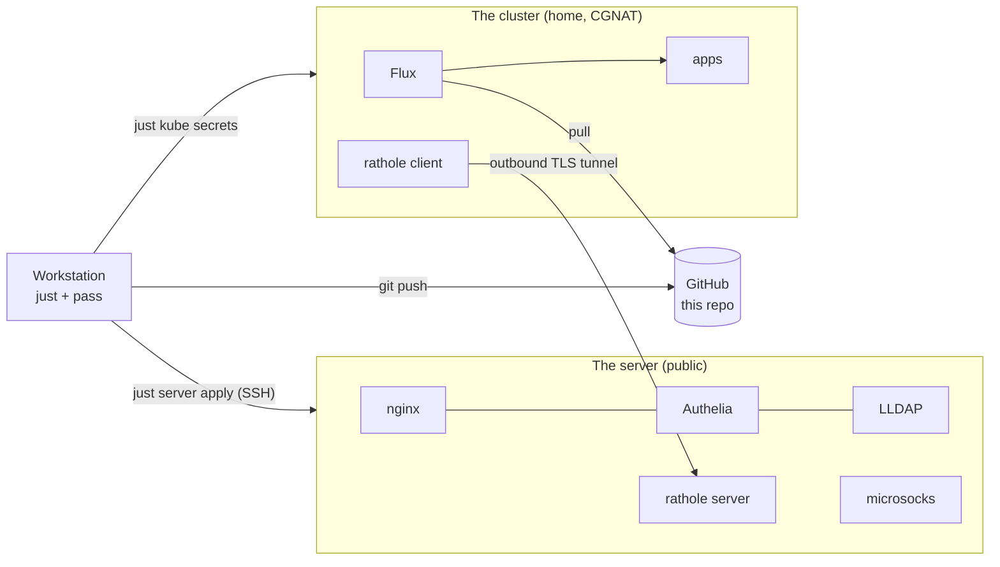
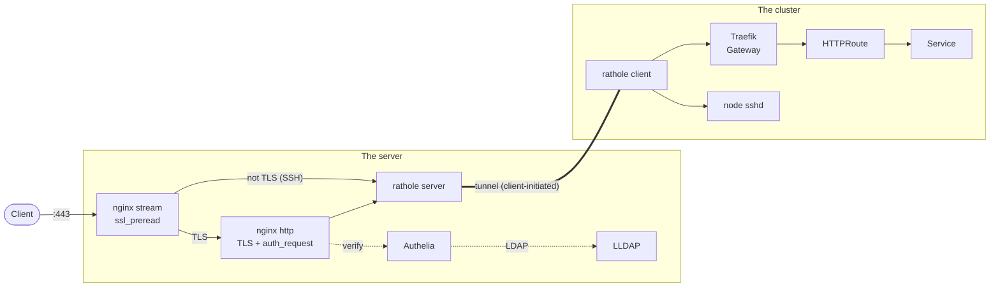
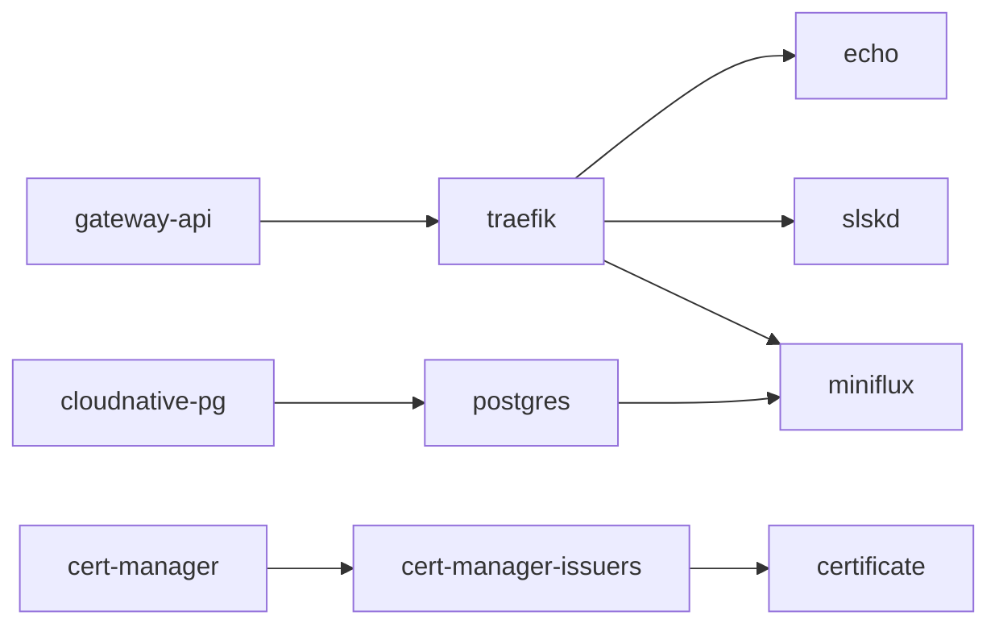
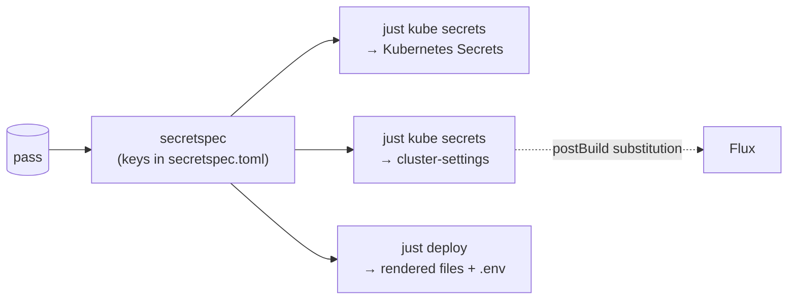
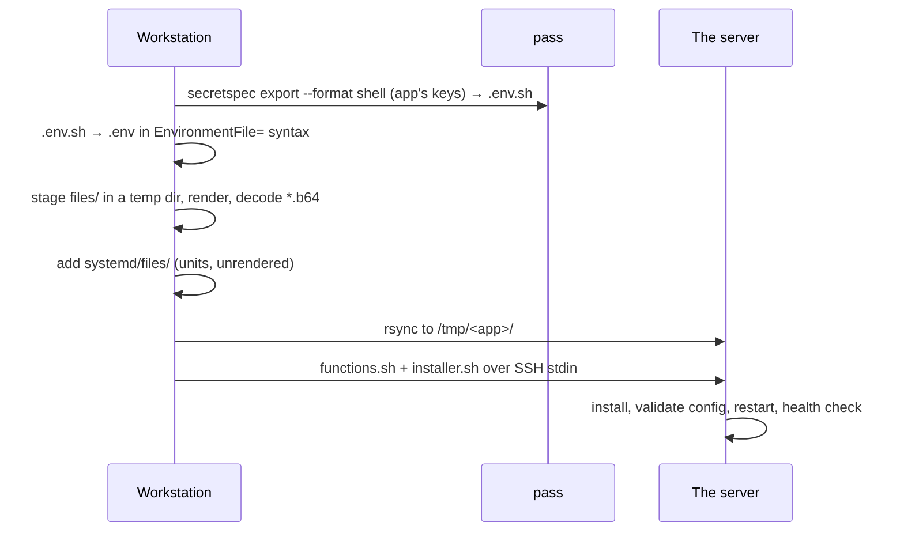

# Architecture

Two machines, one repository, no secrets in git.

- **The server** is a small public VPS. It terminates TLS, authenticates
  users and forwards traffic. Its services run under systemd and are deployed
  over SSH.
- **The cluster** is a single-node [k3s] cluster at home, behind CGNAT. It
  runs the applications. [Flux] reconciles it from this repository.
- **[pass]** holds every secret and every private value (domain, host names,
  emails, ports). [secretspec] reads them at deploy time; git only holds the
  key names.



## Traffic

The cluster has no public address. A [rathole] client inside the cluster
dials out to the server and holds a TLS tunnel open; the server exposes
the tunnel's services on local ports.



1. **Port 443 is shared.** nginx's [stream module][ssl_preread] peeks at
   the first bytes of each connection: a TLS ClientHello goes to the HTTP
   server on a unix socket, anything else to the SSH service in the tunnel.
2. **TLS ends on the server**, with a wildcard Let's Encrypt certificate
   issued by [certbot] (DNS-01).
3. **Authentication happens at the edge.** Protected sites call Authelia
   through [`auth_request`][auth_request]
   ([Authelia's nginx integration][authelia-nginx]); Authelia checks users
   against LLDAP. The cluster sees authenticated requests only.
4. **Routing happens in the cluster.** The tunnel ends at Traefik, the
   [Gateway API] implementation; each app attaches an `HTTPRoute`.

Each site is one file in
[`apps/ingress/files/sites-enabled/`](../apps/ingress/files/sites-enabled/)
and includes either `site-protected` or `site-insecure` from `snippets/`.

### Soulseek

[slskd] needs inbound peers and must not advertise the home address:

- **Outbound:** through the [microsocks] SOCKS5 proxy on the server, so peers
  see the server's address.
- **Inbound:** the listen port is a rathole service, so the server accepts
  the connection and the tunnel carries it to slskd.

Both ports come from pass and are shared by the server and the cluster; see
[Values shared with the server](../kubernetes/README.md#values-shared-with-the-server).

## The cluster

| Layer | Component |
|---|---|
| Distribution | [k3s], single node; its bundled Traefik and Helm controller are disabled ([`k3s/config.yaml`](../kubernetes/k3s/config.yaml)) |
| GitOps | [Flux], installed and upgraded by the [Flux Operator] from a `FluxInstance` |
| Ingress | [Traefik] implementing the [Gateway API]; a `websecure` listener with the wildcard certificate, not public yet (the server's nginx still terminates TLS) |
| Certificates | [cert-manager]: `<domain>` + `*.<domain>` from Let's Encrypt, DNS-01 on Cloudflare with a token limited to the zone's DNS |
| Database | [CloudNativePG] operator and one Postgres cluster |
| Apps | [app-template] HelmReleases: echo, miniflux, slskd, rathole client |
| Operations | [Reloader] restarts pods when their Secrets change; [Renovate] opens update PRs; CI runs `just check` and `just kube check`; Flux errors go to Telegram |
| Backups | Nightly [restic] CronJob: a miniflux `pg_dump` and `/opt/slskd`, encrypted on the node, to Backblaze B2 |

The FluxInstance makes Flux sync [`kubernetes/flux/cluster`](../kubernetes/flux/cluster), whose `cluster-apps`
Kustomization applies every namespace in
[`kubernetes/apps`](../kubernetes/apps), the layout of
[onedr0p/home-ops]:

```
kubernetes/apps/<namespace>/
├── kustomization.yaml     namespace + the apps' ks.yaml
├── namespace.yaml
└── <app>/
    ├── ks.yaml            Flux Kustomization (dependsOn, path)
    ├── app/               HelmRelease + chart source
    └── secrets/           Secret templates, applied by just, never by Flux
```

Dependencies are explicit `dependsOn` edges:



Rebuild steps, upgrades and troubleshooting are in
[`kubernetes/README.md`](../kubernetes/README.md).

## Secrets and private values



- **Nothing secret is in git**, encrypted or not. Each consumer has a
  `secretspec.toml` naming its keys; values live in `pass` under
  `secretspec/machines/default/<KEY>`.
- **Flux substitutes non-secret settings only**: `SECRET_DOMAIN`,
  `SERVER_HOSTNAME`, `FLUX_TELEGRAM_CHAT_ID` (the alert chat) and slskd's two
  ports (`RATHOLE_SERVER_SERVICES_SLSKD_PORT`, `MICROSOCKS_PORT`),
  from the `cluster-settings` Secret in each namespace
  ([post-build substitution][flux-subst]). Strict substitution fails a
  Kustomization on any unknown `${VAR}`.
- **Secret values never pass through Flux.** `just kube secrets` renders the
  templates in `secrets/` and applies them server-side.
- **Rendering is scoped.** [envsubst] only replaces the keys of the
  matching spec, so nginx's `$host` or a shell's `$1` stay intact.
- **Binary secrets** (the rathole TLS identity) are stored base64-encoded;
  a rendered `*.b64` file is decoded with mode `600`.

## Apps and deploy targets

An app in [`apps/`](../apps) is one definition that can run in several ways:

```
apps/<app>/
├── secretspec.toml     keys the app needs
├── files/              config shared by every target, rendered at deploy
├── systemd/            installer.sh + units
├── kube/kubectl/       kustomize build | kubectl apply
└── compose/            docker compose up
```

`systemd` is what runs on the server; `kube/kubectl` and `compose` are a
playground for trying other setups. The cluster's apps are separate, under
`kubernetes/apps`, because Flux needs its own layout.

A systemd deploy:



Units stay unrendered: systemd expands their `${VAR}` from an
`EnvironmentFile` (the `.env`, written in systemd's own quoting by
`env_systemd`), so a rendered unit would hold the secret. Installers run with
`set -eux`; [`load_env`](../lib/functions.sh) sources the `.env.sh`, whose
values are single-quoted, with tracing paused.

## Provisioning

| Step | Command | Source |
|---|---|---|
| Create the server | `bin/create-server.sh` | DigitalOcean droplet |
| Harden it | `just server setup root@<ip>` | [`server/etc`](../server/etc): sshd, fail2ban, sysctl, Docker |
| Deploy its apps | `just server apply <host>` | [`server/mod.just`](../server/mod.just) |
| Install k3s | `just kube k3s-install` | [`kubernetes/k3s`](../kubernetes/k3s) |
| Bootstrap Flux | `just kube bootstrap` (runs `just kube secrets` first) | [`kubernetes/apps/flux-system`](../kubernetes/apps/flux-system) |

The server's host name and SSH port never appear in the repository: the
host is an argument (an SSH alias works), the port comes from `pass`.

## Decisions

| Decision | Why | Cost |
|---|---|---|
| Secrets only in `pass` | Nothing to leak from git, even if the repo goes public | Deploys need the workstation's GPG key |
| [just] instead of Ansible/Terraform | Plain shell, readable, no agent or state | Idempotency is each installer's job |
| Edge on a VPS, apps at home | CGNAT; home address stays private | One extra hop; the tunnel is a single point of failure |
| Auth at the edge | One login for every site; the cluster stays simple | Cluster-internal traffic is not authenticated |
| Pinned, held packages | Upgrades only after reading release notes | Manual version bumps |

## References

- [k3s] · [Flux] · [Gateway API] · [Traefik] · [cert-manager] · [CloudNativePG] · [app-template] · [Reloader] · [Renovate] · [restic]
- [rathole] · [nginx `ssl_preread`][ssl_preread] · [nginx `auth_request`][auth_request] · [Authelia][authelia-nginx] · [LLDAP] · [microsocks] · [certbot]
- [pass] · [secretspec] · [just] · [envsubst] · [Flux post-build substitution][flux-subst]
- [onedr0p/home-ops], whose cluster layout this follows

[app-template]: https://bjw-s-labs.github.io/helm-charts/docs/app-template/
[auth_request]: https://nginx.org/en/docs/http/ngx_http_auth_request_module.html
[authelia-nginx]: https://www.authelia.com/integration/proxies/nginx/
[certbot]: https://certbot.eff.org
[cert-manager]: https://cert-manager.io
[CloudNativePG]: https://cloudnative-pg.io
[envsubst]: https://www.gnu.org/software/gettext/manual/html_node/envsubst-Invocation.html
[Flux]: https://fluxcd.io
[Flux Operator]: https://fluxoperator.dev
[flux-subst]: https://fluxcd.io/flux/components/kustomize/kustomizations/#post-build-variable-substitution
[Gateway API]: https://gateway-api.sigs.k8s.io
[just]: https://just.systems
[k3s]: https://k3s.io
[LLDAP]: https://github.com/lldap/lldap
[microsocks]: https://github.com/rofl0r/microsocks
[onedr0p/home-ops]: https://github.com/onedr0p/home-ops
[pass]: https://www.passwordstore.org
[Reloader]: https://github.com/stakater/Reloader
[Renovate]: https://docs.renovatebot.com
[rathole]: https://github.com/rapiz1/rathole
[restic]: https://restic.net
[secretspec]: https://secretspec.dev
[slskd]: https://github.com/slskd/slskd
[ssl_preread]: https://nginx.org/en/docs/stream/ngx_stream_ssl_preread_module.html
[Traefik]: https://doc.traefik.io/traefik/routing/providers/kubernetes-gateway/
